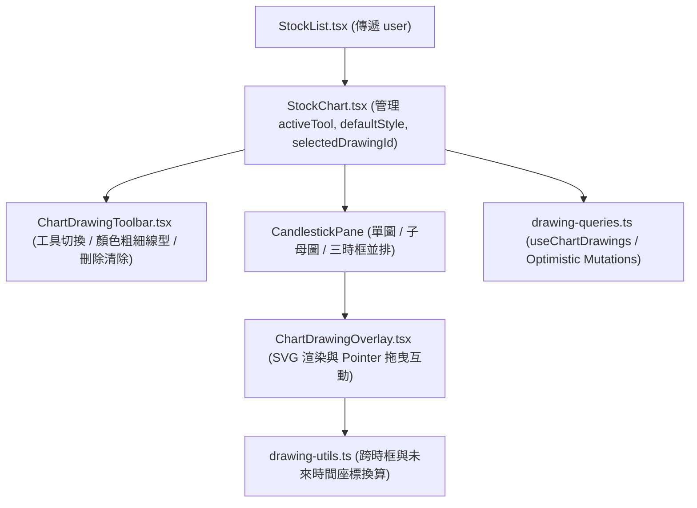

# K 線圖互動畫線系統（水平線與路徑）架構設計規格書

- **日期**：2026-11-14
- **狀態**：已確認設計，待審閱規格書

---

## 1. 背景與目標

本功能旨在為「老余三問自動選股系統」的 K 線圖（[`StockChart.tsx`](file:///Users/gavin/主要入口/coding/stock-screener/src/components/StockChart.tsx)）新增個人化**互動式畫線工具（水平線與多點折線路徑）**與**資料庫持久化**子系統。
使用者在檢視台股或美股標的時，能夠直接在 K 線圖上繪製關鍵支撐/壓力水平線，以及老余破底翻 `P0–P5` 轉折結構路徑（含在最新 K 棒右側的未來預留空白區預畫 `P4`、`P5` 預期走勢）。所有畫線皆與時間刻度及價格軸精準對齊，支援跨時框（`60K` / `日K` / `週K`）與多視窗（單圖、子母圖、三時框並排）即時同步顯示，並持久化儲存於 Supabase PostgreSQL 資料庫中。

所有設計嚴格遵守專案 [`AGENTS.md`](file:///Users/gavin/主要入口/coding/stock-screener/AGENTS.md) 之**零成本營運原則（\$0 成本）**：

- **零商業套件成本**：基於現有 Apache 2.0 開源之 `lightweight-charts` v5.2.1，搭配自建原生 SVG 互動圖層與 `attachPrimitive` 視窗同步鉤子，不引入任何付費圖表 SDK。
- **資料庫容量控制（Supabase Free Tier）**：僅儲存結構化畫線節點與樣式 JSON（每檔股票上限 50 條畫線、每條路徑上限 50 個節點；單檔滿載僅約 `15 KB`），透過 PostgreSQL Trigger 強制把關配額。
- **前端快取與減少請求**：透過 TanStack Query 快取（`staleTime: Infinity`）結合樂觀更新（Optimistic Updates），且在拖曳調整節點時僅於滑鼠放開（`pointerup`）才發送單次資料庫更新，避免拖曳過程產生大量 API 請求。

---

## 2. 功能需求與配額限制

1. **權限與顯示規則**：
   - 與「自選觀察清單（Watchlist）」一致，**僅於已登入狀態（`user != null`）**在 K 線圖頂部工具列顯示畫線控制項，並載入與儲存該使用者的個人畫線紀錄。
   - 未登入訪客僅能瀏覽 K 線圖，不顯示畫線工具列，亦不發送畫線資料庫查詢。
2. **畫線工具種類**：
   - **選取游標（`cursor`）**：預設模式。支援點擊既有畫線進行選取、拖曳控制點修改位置，以及一般 K 線圖平移與縮放。
   - **水平線（`horizontal`）**：滑鼠移入圖表時顯示跟隨游標的水平預覽線與價格；左鍵單擊任一位置即在該價格建立一條橫跨全圖的水平線（並於線段旁顯示價位標籤），建立後自動切回 `cursor` 選取模式。
   - **路徑（`path`，多點折線 Polyline）**：
     - 左鍵單擊依序新增轉折節點 `(time, price)`（如 `P0 -> P1 -> P2 -> P3 -> P4 -> P5`），滑鼠移動時即時渲染從最後一個節點連向當前游標的橡皮筋預覽線（Rubber-band preview）。
     - **支援未來時間區域繪製**：預設將 K 線圖右側留白空間（`DEFAULT_RIGHT_OFFSET`）由 `2` 擴大為 **`12` 根 K 棒寬度**，允許使用者直接在最新一根 K 棒右側的未來空白區點選尚未發生的 `P4`、`P5` 預期位置。
     - **結束繪製觸發條件**：
       1. **滑鼠右鍵（`contextmenu`）**：攔截瀏覽器預設右鍵選單；若當前已點選 $\ge 2$ 個節點則直接完成並儲存該路徑，若僅 $0 \sim 1$ 個節點則取消本次繪製草稿。
       2. **滑鼠左鍵雙擊（`dblclick`）** 或按下鍵盤 **`Enter` / `Escape`**：若已點選 $\ge 2$ 個節點則完成並儲存路徑（`Escape` 若在已有 $\ge 2$ 點時按下亦完成繪製，若僅 1 點則取消），並自動切回 `cursor` 模式。
3. **跨時框共用與時間刻度對齊**：
   - 畫線紀錄綁定 `user_id` 與 `symbol`（跨時框共用）。
   - 在 `60m`（60K）、`1d`（日K）、`1wk`（週K）任一時框繪製的水平線與路徑，在切換時框或處於「子母模式（PIP）」、「三時框並排（Multi）」時，皆會自動對齊各時框的時間軸與價格軸同步渲染。
4. **選取、拖曳編輯、樣式調整與刪除**：
   - **選取**：在 `cursor` 模式下點擊任一水平線或路徑線段，即進入選取狀態並顯示端點圓形控制點（Anchor Handles）。點擊圖表空白處或按 `Escape` 可取消選取。
   - **拖曳調整**：
     - 拖曳水平線控制點（或線段本身）可上下調整水平線價格 `price`。
     - 拖曳路徑的任一節點控制點可自由調整該節點的 `(time, price)`（包含拖入或拖出右側未來空白區）。
     - 拖曳期間鎖定底層 K 線圖的捲動與縮放（`handleScroll: false, handleScale: false`），放開滑鼠（`pointerup`）時恢復底圖互動並寫入 DB。
   - **樣式調整**：
     - **顏色（`color`）**：提供 5 種預設高對比色票（藍 `#3b82f6`、紅 `#ef4444`、綠 `#22c55e`、琥珀 `#f59e0b`、紫 `#a855f7`）。
     - **粗細（`lineWidth`）**：`1`、`2`、`3`（px，預設 `2`）。
     - **線型（`lineStyle`）**：實線 `'solid'`、虛線 `'dashed'`、點線 `'dotted'`（預設 `'solid'`）。
     - 當有選取中的畫線時，點擊工具列上的顏色/粗細/線型會即時更新該條畫線樣式並存入 DB；未選取畫線時則作為下一條新畫線的預設樣式。
   - **刪除與清除**：
     - 選取畫線後，點擊工具列「刪除」按鈕或按鍵盤 `Delete` / `Backspace` 刪除該條畫線。
     - 工具列提供「清除全部」按鈕，一鍵刪除當前股票（`symbol`）底下的所有個人畫線。
5. **配額限制**：
   - 單一帳號在**每一檔股票（`symbol`）最多可儲存 50 條畫線**。
   - 單一條路徑（`path`）**最多可包含 50 個節點**（至少 2 個節點；水平線固定為 1 個節點）。

---

## 3. 資料庫 Schema 與安全設計（Supabase PostgreSQL）

契約檔案將定義於 [`specs/001-daily-screener/contracts/supabase-drawings-schema.sql`](file:///Users/gavin/主要入口/coding/stock-screener/specs/001-daily-screener/contracts/supabase-drawings-schema.sql)，包含資料表定義、配額檢查 Trigger 與 RLS 策略：

### 3.1 資料表結構 (`chart_drawings`)

```sql
CREATE TABLE IF NOT EXISTS chart_drawings (
    id UUID DEFAULT uuid_generate_v4() PRIMARY KEY,
    user_id UUID NOT NULL REFERENCES auth.users(id) ON DELETE CASCADE,
    symbol TEXT NOT NULL,
    tool_type TEXT NOT NULL CHECK (tool_type IN ('horizontal', 'path')),
    points JSONB NOT NULL CHECK (
        jsonb_typeof(points) = 'array'
        AND (
            (tool_type = 'horizontal' AND jsonb_array_length(points) = 1)
            OR (tool_type = 'path' AND jsonb_array_length(points) BETWEEN 2 AND 50)
        )
    ),
    style JSONB NOT NULL DEFAULT '{"color":"#3b82f6","lineWidth":2,"lineStyle":"solid"}'::jsonb,
    created_at TIMESTAMP WITH TIME ZONE DEFAULT NOW(),
    updated_at TIMESTAMP WITH TIME ZONE DEFAULT NOW()
);

CREATE INDEX IF NOT EXISTS idx_chart_drawings_user_symbol
    ON chart_drawings(user_id, symbol, created_at);
```

### 3.2 資料庫層級配額守門員（PostgreSQL Trigger）

```sql
CREATE OR REPLACE FUNCTION check_chart_drawing_quota()
RETURNS TRIGGER AS $$
BEGIN
    IF (
        SELECT COUNT(*)
        FROM chart_drawings
        WHERE user_id = NEW.user_id AND symbol = NEW.symbol
    ) >= 50 THEN
        RAISE EXCEPTION '每檔股票最多只能建立 50 條畫線';
    END IF;
    RETURN NEW;
END;
$$ LANGUAGE plpgsql;

DROP TRIGGER IF EXISTS trg_check_chart_drawing_quota ON chart_drawings;
CREATE TRIGGER trg_check_chart_drawing_quota
BEFORE INSERT ON chart_drawings
FOR EACH ROW EXECUTE FUNCTION check_chart_drawing_quota();
```

### 3.3 資料列層級安全性（RLS）

```sql
ALTER TABLE chart_drawings ENABLE ROW LEVEL SECURITY;

CREATE POLICY "Owner full access on chart_drawings"
ON chart_drawings
FOR ALL
USING (auth.uid() = user_id)
WITH CHECK (auth.uid() = user_id);
```

---

## 4. 跨時框時間刻度對齊與未來座標演算法 (`src/lib/drawing-utils.ts`)

為了讓歷史 K 棒上的節點與最新 K 棒右側的「未來預期節點（如 `P4`、`P5`）」都能在 `60m`、`1d`、`1wk` 之間精準轉換，定義以下純函式：

### 4.1 時框步長定義 (`getIntervalStepSeconds`)

- `'60m'`：`3600`（1 小時）
- `'1d'`：`86400`（1 天）
- `'1wk'`：`604800`（7 天）

### 4.2 畫面像素座標轉邏輯節點 (`pixelToDrawingPoint`)

當使用者在圖表 `(x, y)` 點擊或拖曳節點時：

1. **價格換算**：透過 `candleSeries.coordinateToPrice(y)` 取得價格並四捨五入至小數點後 2 位 `Number(price.toFixed(2))`。
2. **時間換算（支援歷史/當前 K 棒與未來空白區）**：
   - 透過 `chart.timeScale().coordinateToLogical(x)` 取得浮點邏輯索引，四捨五入為整數 K 棒索引 `logicalIdx = Math.round(rawLogical)`。
   - 設最後一根 K 棒索引為 `lastIdx = bars.length - 1`，最後一根 K 棒時間為 `lastBar = bars[lastIdx]`：
     - **若 `logicalIdx <= 0`**：取 `bars[0].time`。
     - **若 `0 < logicalIdx <= lastIdx`（落在既有 K 棒範圍內）**：直接取 `bars[logicalIdx].time`。
     - **若 `logicalIdx > lastIdx`（落在最新 K 棒右側的未來預留區）**：
       計算未來偏移格數 `futureSteps = logicalIdx - lastIdx`，推算未來時間戳：
       `time = lastBar.time + futureSteps * getIntervalStepSeconds(interval)`。

### 4.3 邏輯節點轉畫面像素座標 (`drawingPointToPixel`)

當要在任意時框（`60m` / `1d` / `1wk`）的圖表上將 `DrawingPoint { time, price }` 渲染為 `(x, y)` 像素時：

1. **Y 座標**：直接由 `candleSeries.priceToCoordinate(point.price)` 取得。
2. **X 座標（透過邏輯索引 `logicalIndex` 統一轉換）**：
   - 設當前時框的 `bars` 最後一根索引為 `lastIdx = bars.length - 1`，時間為 `lastBar = bars[lastIdx]`：
   - **情況 A（`point.time <= lastBar.time`，歷史或當前區間）**：
     在升冪排序的 `bars` 中以二分搜尋找出滿足 `bars[i].time <= point.time` 的最大索引 `matchedIdx`（若 `point.time < bars[0].time` 則 `matchedIdx = 0`）。如此一來，在日K週三畫的點，切到週K時會自動對齊到該週週一的週 K 棒索引；在 60K 盤中畫的點，切到日K會自動對齊到當日 K 棒索引。
     接著呼叫 `x = chart.timeScale().logicalToCoordinate(matchedIdx as Logical)`（若測試樁未提供 `logicalToCoordinate` 則回退呼叫 `timeToCoordinate(bars[matchedIdx].time)`）。
   - **情況 B（`point.time > lastBar.time`，未來預期區間，如預畫的 P4 / P5）**：
     計算距離最後一根 K 棒的未來邏輯偏移量（保留浮點數以維持跨時框比例）：
     `futureLogicalOffset = (point.time - lastBar.time) / getIntervalStepSeconds(interval)`
     接著呼叫 `x = chart.timeScale().logicalToCoordinate((lastIdx + futureLogicalOffset) as Logical)`。
     當日後新 K 棒實際生成、`lastBar.time` 往後推進時，原本的 `point.time` 會自動從情況 B 過渡到情況 A，讓新長出的 K 棒自然走進預畫的路徑中。

---

## 5. 前端元件與資料流架構



### 5.1 模組拆分

1. **`src/lib/database.types.ts` & `src/lib/types.ts`**：
   - 新增 `DrawingToolType` (`'horizontal' | 'path'`)、`DrawingLineStyle` (`'solid' | 'dashed' | 'dotted'`)、`DrawingPoint` (`{ time: number; price: number }`)、`DrawingStyle` (`{ color: string; lineWidth: 1 | 2 | 3; lineStyle: DrawingLineStyle }`) 與 `ChartDrawing` 資料列型別。
2. **`src/lib/drawing-utils.ts`**：
   - 封裝 `getIntervalStepSeconds`、`findBarIndexForTime`、`logicalPointToLogicalIndex`、`pixelToDrawingPoint`、`drawingPointToPixel`、`canCreateDrawing`（檢查 50 條上限）、`validateDrawingPoints`（檢查節點數 1 或 2~50）與 SVG `strokeDasharray` 轉換工具。
3. **`src/services/drawing-queries.ts`**：
   - `useChartDrawings(userId, symbol)`：當 `userId` 與 `symbol` 皆存在時查詢 `chart_drawings`，設定 `staleTime: Infinity`。
   - `useChartDrawingMutations(userId, symbol)`：
     - `createDrawing`：樂觀新增畫線（先產生臨時 UUID 立即顯示於畫面上，背景寫入 Supabase 後替換為正式紀錄）。
     - `updateDrawing`：樂觀更新 `points`（拖曳結束時）或 `style`（切換顏色/粗細/線型時）與 `updated_at`。
     - `deleteDrawing`：樂觀刪除單條畫線。
     - `clearSymbolDrawings`：樂觀清空該 `symbol` 的所有個人畫線。
4. **`src/components/ChartDrawingToolbar.tsx`**：
   - 整合於 `StockChart.tsx` 頂部列（僅當 `user != null` 時渲染）。
   - 提供工具切換（`選取`、`水平線`、`路徑`）、樣式控制（5 色票、1px/2px/3px 粗細、實線/虛線/點線）、單條刪除按鈕、全部清除按鈕與配額顯示（`N/50`）。
5. **`src/components/ChartDrawingOverlay.tsx`**：
   - 嵌入於 `CandlestickPane` 內，透過 `attachPrimitive` 訂閱圖表重繪事件，將 `drawings` 陣列與正在繪製中的 `draftPoints` 轉為 SVG `<line>`、`<polyline>`、`<circle>` 控制點與水平線價位標籤。
   - 處理滑鼠左鍵點擊新增節點、移動預覽、右鍵 (`onContextMenu`) / 雙擊 (`onDoubleClick`) / `Enter` / `Escape` 完成或取消路徑繪製，以及選取與控制點拖曳更新。
6. **`src/components/StockChart.tsx` & `src/components/StockList.tsx`**：
   - `StockList.tsx` 將 `user` prop 傳入 `<StockChart stock={selectedStock} user={user} ... />`。
   - `StockChart.tsx` 將 `DEFAULT_RIGHT_OFFSET` 提升至 `12`，並串接 `useChartDrawings`、`ChartDrawingToolbar` 與各 `CandlestickPane` 的畫線狀態。

---

## 6. 錯誤處理與邊界情境

- **未登入訪客隔離**：`user == null` 時不渲染 `ChartDrawingToolbar`，`ChartDrawingOverlay` 亦不啟用任何滑鼠攔截（維持純看圖體驗）。
- **配額達 50 條上限**：當該股票畫線數量達 `50` 條時，工具列中的「水平線」與「路徑」按鈕自動禁用並提示 `已達每檔 50 條上限`。
- **繪製中途切換股票或切換工具**：若路徑繪製到一半（尚未完成）即切換至另一檔股票或點擊其他工具，自動清空未完成的 `draftPoints` 草稿，不寫入髒資料。
- **拖曳防衝突**：開始拖曳控制點或繪製時呼叫 `chart.applyOptions({ handleScroll: false, handleScale: false })`，並在 `pointerup` / `pointercancel` / 元件卸載時確保恢復為 `true`。

---

## 7. 測試策略（TDD）

1. **單元測試（`tests/unit/`，Vitest + Testing Library）**：
   - `drawing-utils.test.ts`：完整測試跨時框時間對齊（`60m` / `1d` / `1wk`）、歷史與當前 K 棒索引查找、右側未來空白區（`P4` / `P5`）時間外推與邏輯索引還原、50 條配額與節點數驗證。
   - `ChartDrawingToolbar.test.tsx`：驗證工具切換、顏色/粗細/線型調整回呼、選取時刪除、全部清除與 50 條滿額禁用狀態。
   - `ChartDrawingOverlay.test.tsx`：驗證水平線單擊建立、路徑多點點擊建立與右鍵（`contextmenu`）/ 雙擊完成繪製、點擊選取線條、控制點拖曳更新座標與按 `Delete` 刪除。
   - `StockChart.test.tsx`：驗證已登入顯示畫線工具列、未登入隱藏工具列，以及預設右側留白 `DEFAULT_RIGHT_OFFSET = 12` 行為。
2. **端對端測試（`tests/e2e/`，Playwright）**：
   - 驗證登入後在 K 線圖上切換水平線與路徑工具、在圖表（含右側未來空白區）點擊繪製路徑並按右鍵完成、切換時框（日K / 週K）確認畫線持續存在並對齊、修改樣式與刪除畫線。
